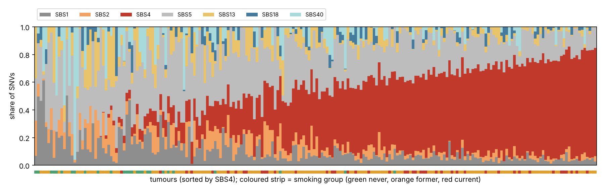
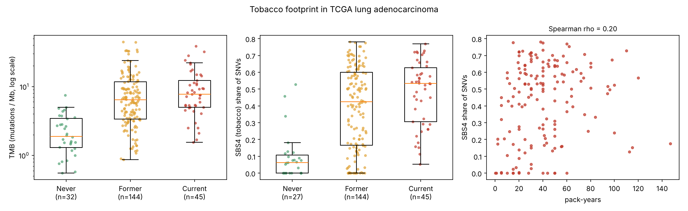
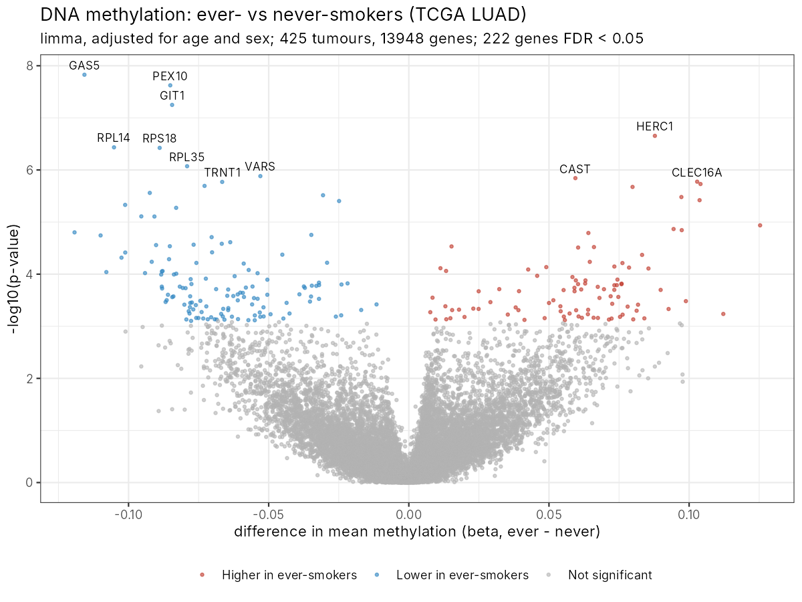
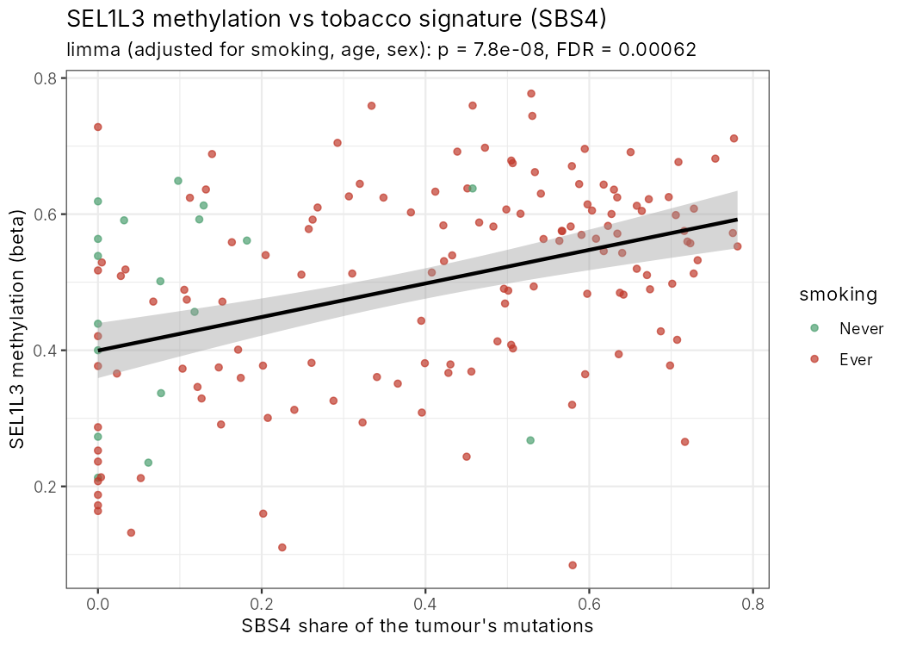

# Tobacco footprints in lung adenocarcinoma genomes and epigenomes

**A reproducible re-analysis of public TCGA data in Python and R**
Author: Andleeb Zahra · 2026


> All code, results and data files are in the folder [`lung-cancer-tobacco-footprints`](lung-cancer-tobacco-footprints). To run the analysis, open that folder first.

## Question

Tobacco smoke contains mutagens such as benzo[a]pyrene. Do these leave a measurable "footprint" in lung tumours? I looked at three layers of the tumour genome:

1. **Mutations.** Which mutational processes (signatures) are active, and is the tobacco signature SBS4 higher in smokers?
2. **Driver genes and genome instability.** Do smokers and never-smokers carry different cancer genes? Does TP53 loss go with more copy-number changes?
3. **DNA methylation.** Does smoking also change the epigenome? Do methylation changes track the amount of tobacco mutation in the same tumour (integration of genetic and epigenetic data)?

## Data

TCGA Lung Adenocarcinoma (Firehose Legacy), downloaded from the public cBioPortal DataHub:

| Data | Tumours used |
|---|---|
| Whole-exome somatic mutations with smoking history | 221 (32 never, 144 former, 45 current) |
| Copy number (GISTIC, per gene) | 221 |
| DNA methylation, Illumina 450K (per gene) with smoking, age and sex | 425 (62 never, 363 ever) |

COSMIC v3.2 SBS reference signatures (GRCh37) are included in `data/reference/`. They were taken from the Alexandrov lab's SigProfilerAssignment repository and re-formatted; `00_download_data.py` downloads them again if the file is missing.

## Methods

| Step | Language | Method |
|---|---|---|
| 01 | Python | Built the 96-channel trinucleotide mutation matrix (pyrimidine-centred); calculated TMB and C>A fraction |
| 02 | Python | De novo signature extraction with NMF (k = 3, scikit-learn); refitting of 7 COSMIC signatures per tumour with non-negative least squares (NNLS); Mann–Whitney, Kruskal–Wallis and Spearman tests |
| 03 | Python | Driver mutations, ever- vs never-smokers (Fisher's exact test, Benjamini–Hochberg FDR); copy-number burden vs TP53 status |
| 04 | R | limma on M-values: (A) ever vs never, adjusted for age and sex; (B) methylation vs SBS4 share, adjusted for smoking status, age and sex; volcano and scatter plots (ggplot2) |

## Key results

**Mutational signatures**

- Without using smoking labels, NMF recovered a signature almost identical to COSMIC **SBS4 (tobacco), with cosine similarity 0.96**.
- Ever-smokers had about 3.6× higher TMB than never-smokers (median 6.8 vs 1.9 mut/Mb; p = 5 × 10⁻¹¹).
- C>A fraction was 0.36 in ever-smokers vs 0.11 in never-smokers (p = 2 × 10⁻¹²).
- SBS4 share was 46% in ever-smokers vs 6% in never-smokers (p = 2 × 10⁻⁹).
- The order Never < Former < Current was clear (Kruskal–Wallis p = 1 × 10⁻⁹).
- SBS4 rose only weakly with pack-years (Spearman ρ = 0.20, p = 0.01). Self-reported pack-years are noisy.

**Driver genes**

- EGFR mutations were more common in never-smokers (31% vs 12%).
- KRAS (35% vs 16%) and TP53 (49% vs 25%) were more common in smokers.
- These differences were nominally significant (p < 0.05) but did **not** pass FDR correction, because only 32 never-smokers were available.

**Genome instability**

- TP53-mutated tumours had more copy-number changes: 64% vs 48% of genes altered (p = 7 × 10⁻⁶).
- Smoking itself did not change copy-number burden (p = 0.27).
- Copy-number burden correlated with TMB (ρ = 0.35).

**Methylation**

- 222 genes differed between ever- and never-smokers (FDR < 0.05; effect sizes up to ±0.12 beta).
- 249 genes tracked the tumour's own SBS4 share even after adjusting for smoking status, age and sex; 20 genes were significant in both analyses.
- The top SBS4-linked genes were SEL1L3 (higher methylation with more tobacco mutations) and FOXI1 (lower methylation).
- Because Part B is adjusted for smoking status, these genes follow the amount of tobacco mutation in the tumour, not just whether the patient smoked.

## Main figures

**Tobacco signature (SBS4) share per tumour, sorted; strip = smoking group**


**Mutation burden and SBS4 by smoking history**


**Methylation differences, ever- vs never-smokers (limma)**


**Top gene whose methylation follows the tobacco signature (adjusted for smoking)**


## Limitations

- **Observational data.** These are associations, not causes.
- **Tumour purity and immune infiltration** may differ between groups and can shift bulk methylation. Purity was not adjusted for.
- **Gene-level methylation** uses one summary value per gene, so CpG-level effects are lost.
- **Small never-smoker group** (32 with mutation data), so power for the driver-gene tests is limited.
- **TMB is approximate** (mutations / 38 Mb exome). Signature refitting is unstable for tumours with fewer than 30 SNVs, so these were excluded.

## How to run

```bash
cd lung-cancer-tobacco-footprints
pip install -r requirements.txt          # Python part
Rscript R/install_packages.R             # R part (ggplot2, limma)
bash run_all.sh                          # downloads ~180 MB and runs everything
```

On Windows (Anaconda Prompt), run the steps one by one from inside the `lung-cancer-tobacco-footprints` folder:

```
python python/00_download_data.py
python python/01_build_tables.py
python python/02_mutational_signatures.py
python python/03_drivers_and_instability.py
Rscript R/04_methylation_smoking.R
```

## Scientific relevance

- **Mutational signatures** (Python 01–02) are a direct read-out of carcinogen exposure. This is the logic of studying how carcinogens shape cancer genomes.
- **Genome instability** (Python 03) asks how TP53 loss allows copy-number chaos.
- **Methylation and integration** (R 04) combine genetic and epigenetic layers of the same tumours.
- **Driver genes such as EGFR and KRAS G12C** decide targeted therapy in the clinic.

## References

- Alexandrov LB et al. (2016) Mutational signatures associated with tobacco smoking in human cancer. *Science* 354:618.
- Alexandrov LB et al. (2020) The repertoire of mutational signatures in human cancer. *Nature* 578:94.
- TCGA Research Network (2014) Comprehensive molecular profiling of lung adenocarcinoma. *Nature* 511:543.
- Ritchie ME et al. (2015) limma powers differential expression analyses. *Nucleic Acids Res* 43:e47.
- Díaz-Gay M et al. (2023) Assigning mutational signatures to individual samples and individual somatic mutations with SigProfilerAssignment. *Bioinformatics* 39:btad756.

## Data and acknowledgements

- The results shown here are based on data generated by the TCGA Research Network (https://www.cancer.gov/tcga), obtained through the cBioPortal DataHub.
- COSMIC v3.2 reference signatures: COSMIC Mutational Signatures (Alexandrov et al. 2020), file from the SigProfilerAssignment repository (AlexandrovLab).
- Code was written with the help of an AI coding assistant. I ran, checked and interpreted every analysis myself.

## License

Code: MIT License (see `lung-cancer-tobacco-footprints/LICENSE`). Data remain subject to the original TCGA and COSMIC terms.
